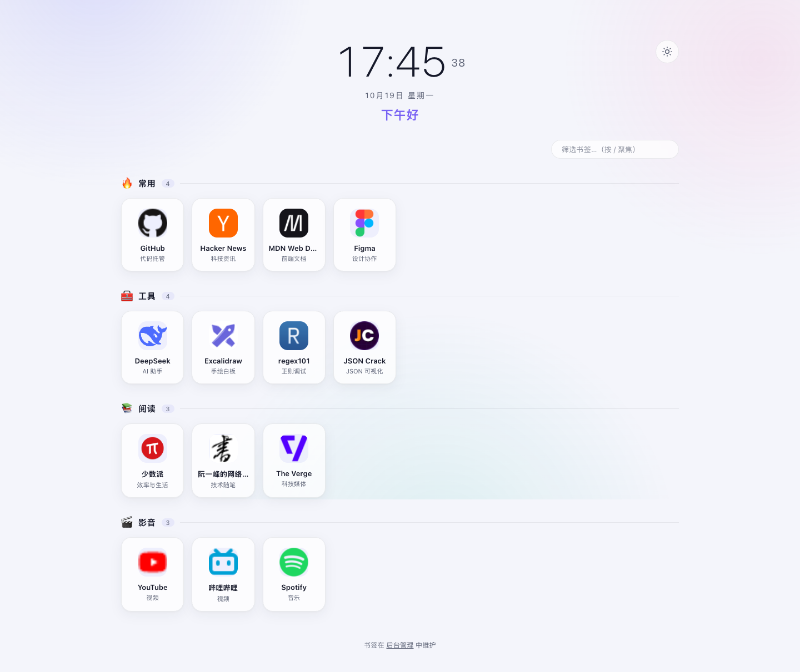
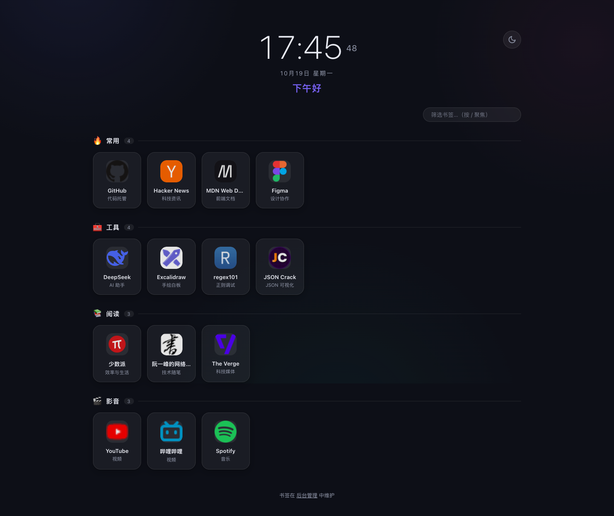

# Lodestar · Personal Navigation Page

[简体中文](README.md) | **English**

[](https://github.com/XiaolongZhang-TT/lodestar/actions/workflows/ci.yml)
[](https://github.com/XiaolongZhang-TT/lodestar/releases)
[](LICENSE)
[](https://www.python.org/)

> A lightweight, self-hosted personal navigation page: **single-file Flask backend + vanilla
> frontend**, with a login-protected admin panel and JSON file storage.
> **Lodestar** means the North Star — every bookmark is a star along your browsing path.



<details>
<summary>🌙 Dark theme screenshot</summary>



</details>

## Features

- 🕐 Large clock with time-of-day greeting
- 🧩 Card-based bookmarks with automatic favicon discovery (favicon / declared icons), colored
  initials fallback, and optional emoji override
- 🔍 Instant client-side bookmark filter (`/` to focus)
- 🔐 **Admin panel** (`/admin`): create / edit / delete categories and links, change page title,
  auto-fill missing URL schemes, unsaved-changes warning
- 🌙 Light / dark themes that follow the system by default and remember manual choice
- 📱 Responsive layout + PWA (add to home screen on mobile)
- 🗄️ JSON storage with atomic writes, rolling backups and `.bak` fallback
- 🐳 Dockerfile / docker compose, buildable on x86 and ARM (Synology, Raspberry Pi, ...)

## Quick start

### Option 1: Docker Compose (recommended)

```bash
git clone https://github.com/XiaolongZhang-TT/lodestar.git
cd lodestar
cp .env.example .env
# edit .env and change NAV_PASS to a strong password
docker compose up -d --build
```

- Home: `http://<server-ip>:8091`
- Admin: `http://<server-ip>:8091/admin`

### Option 2: Prebuilt image (GHCR)

GitHub Actions builds multi-arch (`linux/amd64`, `linux/arm64`) images on every release tag:

```bash
docker run -d --name lodestar \
  -p 8091:8091 \
  -e NAV_USER=admin \
  -e NAV_PASS='change-me' \
  -v "$PWD/data:/app/data" \
  --restart unless-stopped \
  ghcr.io/xiaolongzhang-tt/lodestar:latest
```

> Image: `ghcr.io/xiaolongzhang-tt/lodestar` (see [Releases](https://github.com/XiaolongZhang-TT/lodestar/releases)
> for tags). If the pull is denied, build from source with Option 1 instead.

### Option 3: Run locally

Requires Python 3.9+.

```bash
git clone https://github.com/XiaolongZhang-TT/lodestar.git
cd lodestar
python3 -m venv .venv && source .venv/bin/activate
pip install -r requirements.txt
python3 server.py
```

Open <http://127.0.0.1:8091> (admin at `/admin`).

The default credentials are `admin` / `lodestar-admin` (the startup log warns you).
**Change them for any real deployment:**

```bash
NAV_USER=your-user NAV_PASS=your-strong-password python3 server.py
```

## Configuration

| Variable | Default | Description |
|---|---|---|
| `NAV_USER` | `admin` | Admin username |
| `NAV_PASS` | `lodestar-admin` | Admin password — change it in production |
| `NAV_PORT` | `8091` | Listen port |

With docker compose, put these in a `.env` file next to `docker-compose.yml`
(see [`.env.example`](.env.example)).

## Data and security

| Path | Description |
|---|---|
| `data/bookmarks.json` | Bookmark data, rotated to a backup on every save |
| `data/backups/` | Last 10 historical backups |
| `data/secret.key` | HMAC signing key for sessions, generated on first start (mode 600) |
| `data/icons/` | Icon cache: 7 days for hits, 10 minutes for misses; delete to force refresh |

- The committed `data/bookmarks.json` is **demo data**. Keep your real bookmarks local
  (e.g. `data/bookmarks.private.json`, already ignored by `.gitignore`) and never commit them
- Login uses constant-time comparison and a 0.5s delay on failure, then a signed HttpOnly
  cookie valid for one week
- `POST /api/data` requires a valid session; `GET /api/data` is public (the page itself is public)
- The icon proxy only resolves hosts that appear in your bookmarks, preventing abuse as an open proxy
- To invalidate all sessions, delete `data/secret.key` and restart
- This is a **single-user** app with no role separation. Put it behind a reverse proxy with HTTPS,
  or keep it on your LAN / VPN. See [SECURITY.md](SECURITY.md) for details.

## Managing bookmarks

Everything happens at `http://<your-host>/admin`:

- Categories: rename, change emoji, add, delete (with confirmation)
- Links: edit emoji, name, URL and note; add or remove rows
- Page title and greeting name can be changed at the top; click **Save** to persist

## Development

```bash
make dev    # install runtime + dev dependencies (pytest / ruff)
make test   # run tests
make lint   # lint
make run    # run locally
```

Equivalent without Make:

```bash
pip install -r requirements-dev.txt
python3 -m pytest
python3 -m ruff check .
```

If you change files under `static/`, bump the `?v=N` cache-busting version in
`index.html` / `admin.html`.

## Project layout

```
lodestar/
├── server.py            # Flask backend: data, sessions, icon proxy, routes
├── static/              # Vanilla frontend and PWA assets
│   ├── index.html + app.js     # Home: clock / rendering / filter / icon retry
│   ├── admin.html + admin.js   # Admin: login / editing / unsaved guard
│   ├── style.css               # Shared styles (light + dark variables)
│   └── manifest.webmanifest + icon.svg
├── tests/               # pytest: pure functions + API tests
├── docs/                # README screenshots
├── .github/             # CI, image publishing, Dependabot, issue/PR templates
├── Dockerfile / docker-compose.yml
├── requirements.txt / requirements-dev.txt
├── pyproject.toml       # pytest / ruff configuration
├── Makefile
└── data/                # Runtime data (demo bookmarks in this repo)
```

## Contributing

Issues and pull requests are welcome. Please read [CONTRIBUTING.md](CONTRIBUTING.md) and
[CODE_OF_CONDUCT.md](CODE_OF_CONDUCT.md) first. For security issues, use the private
reporting process in [SECURITY.md](SECURITY.md) instead of a public issue.

## License

[MIT License](LICENSE) © 2026 Xiaolong Zhang
